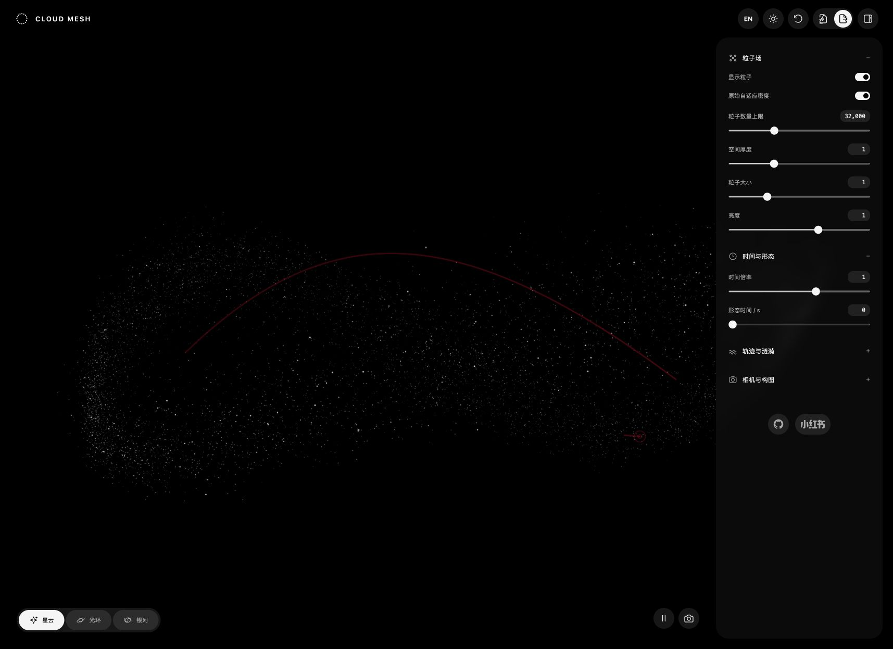

# Cloud Mesh · 粒子星云



**简体中文** · [English](README.en.md)

可实时调参的 WebGL 粒子场。通过星云、光环和银河三种预设，探索粒子、轨迹、涟漪与空间透视。

**[在线体验 →](https://particle-orbit-studio.justvine11.chatgpt.site/)**

## 功能

- **三种预设**：星云、光环、银河，支持恢复原始参数。
- **实时调参**：粒子数量、大小、亮度、空间厚度、时间倍率与形态时间。
- **轨迹与涟漪**：独立显示开关、速度与不透明度；共享二维色板、色相条及 HEX 输入。
- **空间交互**：鼠标按住拖拽旋转视角，滚轮缩放；可调整相机角度、取景和景深。
- **显示控制**：关闭粒子时仍可保留轨迹与涟漪；支持暂停和继续。
- **主题与语言**：深色 / 浅色皮肤，中英文切换，每次打开默认中文。
- **配置与导出**：JSON 配置导入 / 导出，PNG 画面保存。
- **界面**：磨砂悬浮参数面板、弹性展开动画和图标工具栏。

手动粒子数量上限为 100,000；默认使用原始自适应密度，上限 32,000。实际密度、性能和景深效果受设备与画布尺寸影响。

## 本地运行

无需 npm 安装或构建。安装 Python 3 后，在项目根目录运行：

```sh
python3 -m http.server 8765 --directory dist
```

打开 <http://localhost:8765/>。请使用 HTTP 服务，不要直接双击 HTML。浏览器需要支持 WebGL。

## 作为模块使用

将 `dist/` 中的运行文件部署到同一目录，并加载 `style.css`，为容器设置明确的宽高：

```js
import { CloudMesh } from './mesh.js';

const mesh = new CloudMesh(document.querySelector('#scene'));
mesh.set({ size: 1.2, animate: false });
// 不再使用时释放渲染资源
mesh.destroy();
```

完整参数见 [`dist/mesh.js`](dist/mesh.js) 的 `defaults`。`morph` 表示场景时间（秒）。

## 项目结构

```text
dist/
  index.html       页面结构
  boot.js          加载状态与初始化
  app.js           控件、交互与配置管理
  i18n.js          中英文界面
  style.css        主题与布局
  mesh.js          粒子场封装
  vendor/original.js  提取的第三方渲染运行时
docs/screenshot.png
```

静态托管时，将 `dist/` 作为发布目录。GPU 分级会请求 `cdn.openai.com/webgl/detect-gpu`；请求失败时使用降级配置。

## 来源与许可

粒子效果源自 [OpenAI 页面](https://openai.com/index/hugging-face-incident-and-the-road-ahead/)。项目保留了提取的场景、着色器、涟漪与后处理逻辑，并添加独立参数面板和交互封装。项目与 OpenAI 无隶属或背书关系。

本项目原创界面与封装代码采用 [MIT 许可](LICENSE)。**该许可不覆盖 `dist/vendor/original.js` 中的第三方代码**；其再分发和使用权利尚未核实，因此完整运行时不能被视为全部获得 MIT 授权。详细来源见 [THIRD_PARTY_NOTICES.md](THIRD_PARTY_NOTICES.md)。
